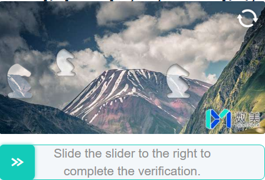

import Tabs from '@theme/Tabs';
import TabItem from '@theme/TabItem';
import ParamItem from '@theme/ParamItem';
import MethodItem from '@theme/MethodItem';
import ImageWrap from '@theme/ImageWrap';
import ImagesLayout from '@theme/ImagesLayout';
import MethodDescription from '@theme/MethodDescription'
import PriceBlock from '@theme/PriceBlock';
import PriceBlockWrap from '@theme/PriceBlockWrap';
import { ArticleHead } from '../../src/theme/ArticleHead';
import McpNotice from '@site/src/components/McpNotice';

<ArticleHead slug="captchas/fengkongcloud-task" />

# FengkongCloud

<PriceBlockWrap>
  <PriceBlock title="FengkongCloud" captchaId="fengkongcloud"/>
</PriceBlockWrap>

<McpNotice />

FengkongCloud — это решение для защиты сайтов от автоматизированных действий. Оно анализирует поведение пользователя и генерирует токен, подтверждающий легитимность активности.

## Примеры заданий

Ниже представлен пример типа задания FengkongCloud, который на данный момент поддерживается сервисом CapMonster Cloud:

<ImagesLayout gap="16px" columns={3}>
  <ImageWrap title="Slider"></ImageWrap>
</ImagesLayout>
<br />

## Параметры запроса

<div className="bordered-panel">
    <ParamItem title="type" required type="string" />
    **CustomTask**

    ---

    <ParamItem title="class" required type="string" />
    **fengkongcloud**

    ---

    <ParamItem title="websiteURL" required type="string" />
    Адрес основной страницы, на которой находится капча.

    ---

    <ParamItem title="websiteKey" required type="string" />
    Значение параметра siteKey, найденное на странице.

    ---

    <ParamItem title="apiJsUrl (внутри metadata)" type="string" />
    Ссылка на `smcp.min.js`. Пример: `https://castatic.fengkongcloud.com/pr/vX.X.X/smcp.min.js`

    ---

    <ParamItem title="userAgent" type="string" />
    User-Agent браузера. Используйте текущее значение, поддерживаемое CapMonster Cloud: `userAgentPlaceholder`<br />

Актуальное значение можно получить по адресу: [https://capmonster.cloud/api/useragent/actual](https://capmonster.cloud/api/useragent/actual).

</div>

## Метод создания задачи

<div className="method-panel">
	<MethodItem>
      ```http
      https://api.capmonster.cloud/createTask
      ```
    </MethodItem>
    <MethodDescription>

    **Пример запроса**

```json
{
  "clientKey": "API_KEY",
  "task": {
    "type": "CustomTask",
    "class": "fengkongcloud",
    "websiteURL": "https://www.example.com/",
    "websiteKey": "your-website-key",
    "userAgent": "userAgentPlaceholder",
    "metadata": {
      "apiJsUrl": "https://castatic.fengkongcloud.com/pr/vX.X.X/smcp.min.js"
    }
  }
}
```

    **Пример ответа**

    ```json
    {
      "errorId": 0,
      "taskId": 407533072
    }
    ```

    </MethodDescription>
  </div>

## Метод получения результата задачи
Используйте метод [getTaskResult](../api/methods/get-task-result.mdx) для получения решения FengkongCloud.

<div className="method-panel-full">
	<MethodItem>
		```http
		https://api.capmonster.cloud/getTaskResult
		```
	</MethodItem>
	<MethodDescription>
		**Пример запроса**
		```json
		{
		  "clientKey":"API_KEY",
		  "taskId": 407533072
		}
		```
		**Пример ответа**
```json
{
  "errorId": 0,
  "cost": 0.0006,
  "status": "ready",
  "solution": {
    "data": {
      "token": "abc123def456.....78"
    }
  }
}
```
	</MethodDescription>
</div>

## Как найти websiteKey

1. Откройте страницу с капчей FengkongCloud.
2. Откройте **Инструменты разработчика** (**F12** или правый клик → **Inspect**).
3. Перейдите на вкладку **Network** и перезагрузите страницу.
4. Найдите запрос к URL, содержащему `/conf`, с параметрами типа `appid` или `organization`.
5. Значение параметра `appid` является `websiteKey`.

Альтернативно, поищите в исходном коде страницы `appid` или скрипты, загружаемые с доменов `fengkongcloud.com`.

## Как найти apiJsUrl

1. В **Инструментах разработчика** перейдите на вкладку **Network**.
2. Отфильтруйте запросы, чтобы найти скрипт, загружаемый с `castatic.fengkongcloud.com`.
3. Найдите файл с именем `smcp.min.js` и скопируйте его полный URL.
