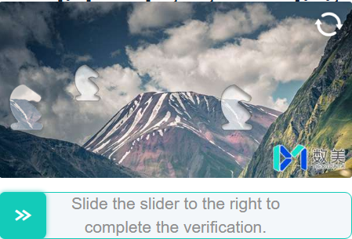

import Tabs from '@theme/Tabs';
import TabItem from '@theme/TabItem';
import ParamItem from '@theme/ParamItem';
import MethodItem from '@theme/MethodItem';
import ImageWrap from '@theme/ImageWrap';
import ImagesLayout from '@theme/ImagesLayout';
import MethodDescription from '@theme/MethodDescription'
import PriceBlock from '@theme/PriceBlock';
import PriceBlockWrap from '@theme/PriceBlockWrap';
import { ArticleHead } from '../../../../../src/theme/ArticleHead';
import McpNotice from '@site/src/components/McpNotice';

<ArticleHead slug="captchas/fengkongcloud-task" />

# FengkongCloud

<PriceBlockWrap>
  <PriceBlock title="FengkongCloud" captchaId="fengkongcloud"/>
</PriceBlockWrap>

<McpNotice />

FengkongCloud is a captcha solution that protects websites from automated actions. It analyzes user behavior and generates a token that confirms legitimate activity.

## Examples of tasks

Below is an example of a FengkongCloud task type currently supported by CapMonster Cloud:

<ImagesLayout gap="16px" columns={3}>
  <ImageWrap title="Slider"></ImageWrap>
</ImagesLayout>
<br />

## Request parameters

<div className="bordered-panel">
    <ParamItem title="type" required type="string" />
    **CustomTask**

    ---

    <ParamItem title="class" required type="string" />
    **fengkongcloud**

    ---

    <ParamItem title="websiteURL" required type="string" />
    The address of the main page where the captcha is located.

    ---

    <ParamItem title="websiteKey" required type="string" />
    The value of the siteKey parameter found on the page.

    ---

    <ParamItem title="apiJsUrl (inside metadata)" type="string" />
    Link to `smcp.min.js`. Example: `https://castatic.fengkongcloud.com/pr/vX.X.X/smcp.min.js`

    ---

    <ParamItem title="userAgent" type="string" />
    Browser User-Agent. Use the current value supported by CapMonster Cloud: `userAgentPlaceholder`<br />

You can get the latest value at: [https://capmonster.cloud/api/useragent/actual](https://capmonster.cloud/api/useragent/actual).

</div>

## Create task method

<div className="method-panel">
	<MethodItem>
      ```http
      https://api.capmonster.cloud/createTask
      ```
    </MethodItem>
    <MethodDescription>

    **Request example**

```json
{
  "clientKey": "API_KEY",
  "task": {
    "type": "CustomTask",
    "class": "fengkongcloud",
    "websiteURL": "https://www.example.com/",
    "websiteKey": "your-website-key",
    "userAgent": "userAgentPlaceholder",
    "metadata": {
      "apiJsUrl": "https://castatic.fengkongcloud.com/pr/vX.X.X/smcp.min.js"
    }
  }
}
```

    **Response example**

    ```json
    {
      "errorId": 0,
      "taskId": 407533072
    }
    ```

    </MethodDescription>
  </div>

## Get task result method
Use the method [getTaskResult](../api/methods/get-task-result.mdx) to obtain the FengkongCloud solution.

<div className="method-panel-full">
	<MethodItem>
		```http
		https://api.capmonster.cloud/getTaskResult
		```
	</MethodItem>
	<MethodDescription>
		**Request example**
		```json
		{
		  "clientKey":"API_KEY",
		  "taskId": 407533072
		}
		```
		**Response example**
```json
{
  "errorId": 0,
  "cost": 0.0006,
  "status": "ready",
  "solution": {
    "data": {
      "token": "abc123def456.....78"
    }
  }
}
```
	</MethodDescription>
</div>

## How to find the websiteKey

1. Open the page with FengkongCloud captcha.
2. Open **Developer Tools** (**F12** or right-click → **Inspect**).
3. Go to the **Network** tab and reload the page.
4. Look for a request to a URL containing `/conf` with parameters like `appid` or `organization`.
5. The `appid` parameter value is the `websiteKey`.

Alternatively, search the page source code for `appid` or look for scripts loading from `fengkongcloud.com` domains.

## How to find the apiJsUrl

1. In **Developer Tools**, go to the **Network** tab.
2. Filter requests to find the script loading from `castatic.fengkongcloud.com`.
3. Look for a file named `smcp.min.js` and copy its full URL.
