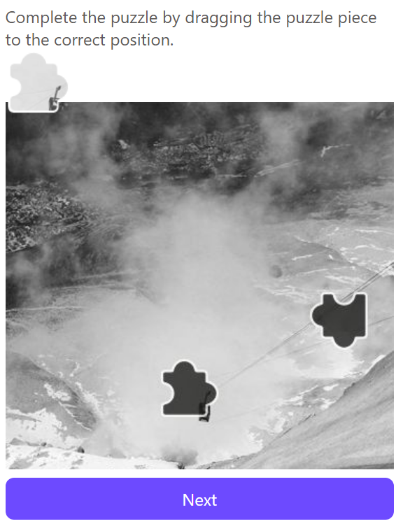

import ParamItem from '@theme/ParamItem';
import MethodItem from '@theme/MethodItem';
import ImageWrap from '@theme/ImageWrap';
import ImagesLayout from '@theme/ImagesLayout';
import MethodDescription from '@theme/MethodDescription'
import PriceBlock from '@theme/PriceBlock';
import PriceBlockWrap from '@theme/PriceBlockWrap';
import { ArticleHead } from '../../../../../src/theme/ArticleHead';
import McpNotice from '@site/src/components/McpNotice';

<ArticleHead slug="captchas/proton-task" />

# Proton Captcha

<PriceBlockWrap>
  <PriceBlock title="Proton Captcha" captchaId="proton"/>
</PriceBlockWrap>

<McpNotice />

Proton Captcha is a security system used on Proton services to verify legitimate user activity and protect against automated actions. Proxy is required to solve this captcha type.

## Examples of tasks

Below is an example of the Proton Captcha task type currently supported by CapMonster Cloud:

<ImagesLayout gap="16px" columns={3}>
  <ImageWrap title="Puzzle"></ImageWrap>
</ImagesLayout>
<br />

## Request parameters

<div className="bordered-panel">
    <ParamItem title="type" required type="string" />
    **CustomTask**

    ---

    <ParamItem title="class" required type="string" />
    **proton**

    ---

    <ParamItem title="websiteURL" required type="string" />
    The address of the main page where the captcha is located.

    ---

    <ParamItem title="HumanVerificationToken (inside metadata)" required type="string" />
    Token from the response.

    ---

    <ParamItem title="pageAction (inside metadata)" required type="string" />
    Action on the site: `login` or `signup`

    ---

    <ParamItem title="userAgent" type="string" />
    Browser User-Agent. Use the current value supported by CapMonster Cloud: `userAgentPlaceholder`<br />

You can get the latest value at: [https://capmonster.cloud/api/useragent/actual](https://capmonster.cloud/api/useragent/actual).

    ---

    <ParamItem title="proxyType" required type="string" />
    **http** - regular http/https proxy;<br />**https** - try this option only if "http" doesn't work (required for some custom proxies);<br />**socks4** - socks4 proxy;<br />**socks5** - socks5 proxy.

    ---

    <ParamItem title="proxyAddress" required type="string" />
    <p>
      IPv4/IPv6 proxy IP address. Not allowed:
      - using transparent proxies (where you can see the client's IP);
      - using proxies on local machines.
    </p>

    ---

    <ParamItem title="proxyPort" required type="integer" />
    Proxy port.

    ---

    <ParamItem title="proxyLogin" required type="string" />
    Proxy server login.

    ---

    <ParamItem title="proxyPassword" required type="string" />
    Proxy server password.

</div>

## Create task method

<div className="method-panel">
  <MethodItem>
    ```http
    https://api.capmonster.cloud/createTask
    ```
  </MethodItem>
  <MethodDescription>
    **Request example**
    ```json
    {
      "clientKey": "API_KEY",
      "task": {
        "type": "CustomTask",
        "class": "proton",
        "websiteURL": "https://yourwebsite.com/",
        "userAgent": "userAgentPlaceholder",
        "metadata": {
          "HumanVerificationToken": "your-verification-token",
          "pageAction": "login"
        },
        "proxyType": "http",
        "proxyAddress": "8.8.8.8",
        "proxyPort": 8080,
        "proxyLogin": "proxyLoginHere",
        "proxyPassword": "proxyPasswordHere"
      }
    }
    ```

    **Response example**
    ```json
    {
      "errorId": 0,
      "taskId": 407533072
    }
    ```
  </MethodDescription>
</div>

## Get task result method
Use the method [getTaskResult](../api/methods/get-task-result.mdx) to obtain the Proton Captcha solution.

<div className="method-panel-full">
	<MethodItem>
		```http
		https://api.capmonster.cloud/getTaskResult
		```
	</MethodItem>
	<MethodDescription>
		**Request example**
		```json
		{
		  "clientKey":"API_KEY",
		  "taskId": 407533072
		}
		```
		**Response example**
```json
{
  "errorId": 0,
  "cost": 0.001,
  "status": "ready",
  "solution": {
    "data": {
      "tokens": "TOKEN_VALUE_HERE....."
    }
  }
}
```
	</MethodDescription>
</div>

## How to find the HumanVerificationToken

1. Open the page with Proton Captcha.
2. Open **Developer Tools** (**F12** or right-click → **Inspect**).
3. Go to the **Network** tab and perform the action that triggers the captcha.
4. Look for a request that returns the `HumanVerificationToken` in the response body.
5. Copy the token value and pass it in the `metadata.HumanVerificationToken` field.

## How to find the pageAction

The `pageAction` parameter depends on the action being performed on the website:
- Use `login` when the user is logging in
- Use `signup` when the user is creating a new account
