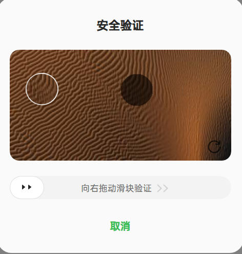
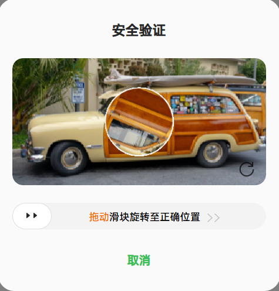

import Tabs from '@theme/Tabs';
import TabItem from '@theme/TabItem';
import ParamItem from '@theme/ParamItem';
import MethodItem from '@theme/MethodItem';
import ImageWrap from '@theme/ImageWrap';
import ImagesLayout from '@theme/ImagesLayout';
import MethodDescription from '@theme/MethodDescription'
import PriceBlock from '@theme/PriceBlock';
import PriceBlockWrap from '@theme/PriceBlockWrap';
import { ArticleHead } from '../../../../../src/theme/ArticleHead';
import McpNotice from '@site/src/components/McpNotice';

<ArticleHead slug="captchas/heytap-task" />

# HeyTap

<PriceBlockWrap>
  <PriceBlock title="HeyTap" captchaId="heytap"/>
</PriceBlockWrap>

<McpNotice />

HeyTap Captcha é um sistema de segurança que protege sites de ações automatizadas. Ele analisa o comportamento do usuário e gera um token para confirmar atividade legítima.

## Exemplos de tarefas

Abaixo estão exemplos dos subtipos de tarefas HeyTap:

<ImagesLayout gap="16px" columns={3}>
  <ImageWrap title="Slider"></ImageWrap>
  <ImageWrap title="Rotate"></ImageWrap>
</ImagesLayout>
<br />

## Parâmetros da solicitação

<div className="bordered-panel">
    <ParamItem title="type" required type="string" />
    **CustomTask**

    ---

    <ParamItem title="class" required type="string" />
    **heytap**

    ---

    <ParamItem title="websiteURL" required type="string" />
    O endereço da página principal onde o captcha está localizado.

    ---

    <ParamItem title="websiteKey" required type="string" />
    O valor do parâmetro siteKey encontrado na página.

    ---

    <ParamItem title="apiServer (dentro da metadata)" type="string" />
    Subdomínio do servidor de API do HeyTap. Especifique apenas o domínio sem o prefixo `https://`. Se for diferente do padrão `captcha-sec.heytapmobi.com`, você deve especificá-lo.

    ---

    <ParamItem title="userAgent" type="string" />
    User-Agent do navegador. Use o valor atual suportado pelo CapMonster Cloud: `userAgentPlaceholder`<br />

Você pode obter o valor mais recente em: [https://capmonster.cloud/api/useragent/actual](https://capmonster.cloud/api/useragent/actual).

</div>

## Método de criação de tarefa

<div className="method-panel">
	<MethodItem>
      ```http
      https://api.capmonster.cloud/createTask
      ```
    </MethodItem>
    <MethodDescription>

    **Exemplo de solicitação**

```json
{
  "clientKey": "API_KEY",
  "task": {
    "type": "CustomTask",
    "class": "heytap",
    "websiteURL": "https://yourwebsite.com/",
    "websiteKey": "your-website-key",
    "userAgent": "userAgentPlaceholder",
    "metadata": {
      "apiServer": "captcha-sec.heytapmobi.com"
    }
  }
}
```

    **Exemplo de resposta**

    ```json
    {
      "errorId": 0,
      "taskId": 407533072
    }
    ```

    </MethodDescription>
  </div>

## Método de obtenção do resultado da tarefa
Use o método [getTaskResult](../api/methods/get-task-result.mdx) para obter a solução do HeyTap.

<div className="method-panel-full">
	<MethodItem>
		```http
		https://api.capmonster.cloud/getTaskResult
		```
	</MethodItem>
	<MethodDescription>
		**Exemplo de solicitação**
		```json
		{
		  "clientKey":"API_KEY",
		  "taskId": 407533072
		}
		```
		**Exemplo de resposta**
```json
{
  "errorId": 0,
  "cost": 0.0007,
  "status": "ready",
  "solution": {
    "data": {
      "token": "1A183F8CFC7631B08855D824....."
    }
  }
}
```
	</MethodDescription>
</div>

## Como encontrar o websiteKey

1. Abra a página com o HeyTap Captcha.
2. Abra as **Ferramentas do Desenvolvedor** (**F12** ou clique com o botão direito → **Inspecionar**).
3. Vá para a aba **Network** (Rede) e recarregue a página.
4. Procure por uma solicitação para uma URL contendo a API do captcha HeyTap (geralmente para `heytapmobi.com`).
5. O parâmetro `ak` na URL é o `websiteKey`.

Alternativamente, pesquise no código-fonte da página por parâmetros de inicialização ou objetos de configuração relacionados ao HeyTap.

## Como encontrar o apiServer

1. Nas **Ferramentas do Desenvolvedor**, vá para a aba **Network** (Rede).
2. Procure por solicitações para domínios que terminam com `heytapmobi.com`.
3. Copie o subdomínio (por exemplo, `captcha-sec.heytapmobi.com`).
4. Passe esse valor no campo `metadata.apiServer` sem o prefixo `https://`.
