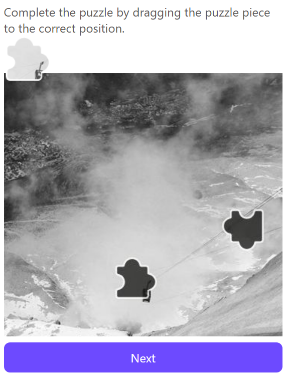

import ParamItem from '@theme/ParamItem';
import MethodItem from '@theme/MethodItem';
import ImageWrap from '@theme/ImageWrap';
import ImagesLayout from '@theme/ImagesLayout';
import MethodDescription from '@theme/MethodDescription'
import PriceBlock from '@theme/PriceBlock';
import PriceBlockWrap from '@theme/PriceBlockWrap';
import { ArticleHead } from '../../../../../src/theme/ArticleHead';
import McpNotice from '@site/src/components/McpNotice';

<ArticleHead slug="captchas/proton-task" />

# Proton Captcha

<PriceBlockWrap>
  <PriceBlock title="Proton Captcha" captchaId="proton"/>
</PriceBlockWrap>

<McpNotice />

Proton Captcha 是 Proton 服务中使用的安全系统，用于验证合法的用户活动并防止自动化操作。解决此验证码类型需要代理。

## 任务示例

下面展示了 CapMonster Cloud 当前支持的 Proton Captcha 验证类型示例：

<ImagesLayout gap="16px" columns={3}>
  <ImageWrap title="Puzzle"></ImageWrap>
</ImagesLayout>
<br />

## 请求参数

<div className="bordered-panel">
    <ParamItem title="type" required type="string" />
    **CustomTask**

    ---

    <ParamItem title="class" required type="string" />
    **proton**

    ---

    <ParamItem title="websiteURL" required type="string" />
    验证码所在主页的地址。

    ---

    <ParamItem title="HumanVerificationToken（位于 metadata 中）" required type="string" />
    来自响应的令牌。

    ---

    <ParamItem title="pageAction（位于 metadata 中）" required type="string" />
    网站上的操作：`login` 或 `signup`

    ---

    <ParamItem title="userAgent" type="string" />
    浏览器 User-Agent。使用 CapMonster Cloud 支持的当前值：`userAgentPlaceholder`<br />

您可以在以下地址获取最新值：[https://capmonster.cloud/api/useragent/actual](https://capmonster.cloud/api/useragent/actual)。

    ---

    <ParamItem title="proxyType" required type="string" />
    **http** - 常规 http/https 代理；<br />**https** - 仅当 "http" 不起作用时才尝试此选项（某些自定义代理需要）；<br />**socks4** - socks4 代理；<br />**socks5** - socks5 代理。

    ---

    <ParamItem title="proxyAddress" required type="string" />
    <p>
      IPv4/IPv6 代理 IP 地址。不允许：
      - 使用透明代理（可以看到客户端 IP）；
      - 在本地机器上使用代理。
    </p>

    ---

    <ParamItem title="proxyPort" required type="integer" />
    代理端口。

    ---

    <ParamItem title="proxyLogin" required type="string" />
    代理服务器登录名。

    ---

    <ParamItem title="proxyPassword" required type="string" />
    代理服务器密码。

</div>

## 创建任务方法

<div className="method-panel">
  <MethodItem>
    ```http
    https://api.capmonster.cloud/createTask
    ```
  </MethodItem>
  <MethodDescription>
    **请求示例**
    ```json
    {
      "clientKey": "API_KEY",
      "task": {
        "type": "CustomTask",
        "class": "proton",
        "websiteURL": "https://yourwebsite.com/",
        "userAgent": "userAgentPlaceholder",
        "metadata": {
          "HumanVerificationToken": "your-verification-token",
          "pageAction": "login"
        },
        "proxyType": "http",
        "proxyAddress": "8.8.8.8",
        "proxyPort": 8080,
        "proxyLogin": "proxyLoginHere",
        "proxyPassword": "proxyPasswordHere"
      }
    }
    ```

    **响应示例**
    ```json
    {
      "errorId": 0,
      "taskId": 407533072
    }
    ```
  </MethodDescription>
</div>

## 获取任务结果方法
使用 [getTaskResult](../api/methods/get-task-result.mdx) 方法获取 Proton Captcha 解决方案。

<div className="method-panel-full">
	<MethodItem>
		```http
		https://api.capmonster.cloud/getTaskResult
		```
	</MethodItem>
	<MethodDescription>
		**请求示例**
		```json
		{
		  "clientKey":"API_KEY",
		  "taskId": 407533072
		}
		```
		**响应示例**
```json
{
  "errorId": 0,
  "cost": 0.001,
  "status": "ready",
  "solution": {
    "data": {
      "tokens": "TOKEN_VALUE_HERE....."
    }
  }
}
```
	</MethodDescription>
</div>

## 如何找到 HumanVerificationToken

1. 打开带有 Proton Captcha 的页面。
2. 打开**开发者工具**（**F12** 或右键单击 → **检查**）。
3. 转到 **Network** 选项卡并执行触发验证码的操作。
4. 查找在响应正文中返回 `HumanVerificationToken` 的请求。
5. 复制令牌值并在 `metadata.HumanVerificationToken` 字段中传递。

## 如何找到 pageAction

`pageAction` 参数取决于网站上执行的操作：
- 用户登录时使用 `login`
- 创建新账户时使用 `signup`
